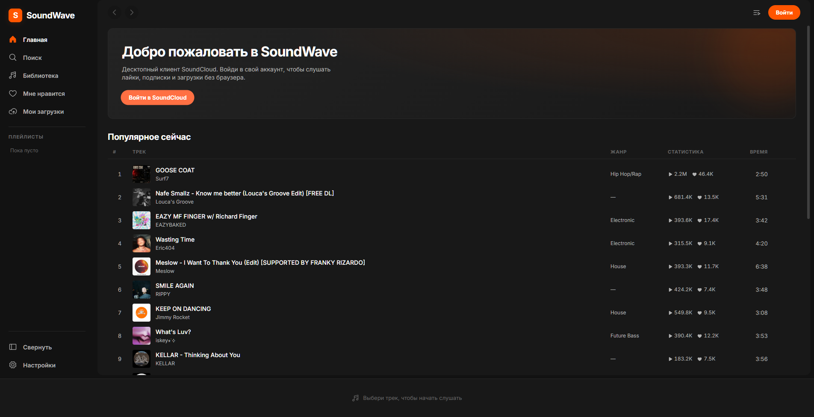

# SoundWave

Десктопный клиент **SoundCloud** в стиле Spotify. Оранжевая тема, смена оформления, глобальные медиа-клавиши, системный трей.





## Что внутри

- **Интерфейс в стиле Spotify** — сайдбар, основной контент, панель плеера, панель очереди
- **Вход в аккаунт SoundCloud** — одно окно входа, два способа внутри него:
  - настоящая страница `soundcloud.com/signin` (пароль вводится на самом SoundCloud)
  - ручной импорт cookies из браузера (Cookie-Editor / EditThisCookie), с автопарсингом форматов
- **Не больше двух окон** — главное окно и одно окно входа, которое переиспользуется
- **Музыка** — лайки, загрузки, плейлисты, поиск треков / артистов / плейлистов
- **Популярное без входа** — на главной гостю показывается charts SoundCloud
- **Плеер** — play/pause, seek, громкость, shuffle, повтор (все / один), очередь
- **Горячие клавиши** — `Space` играть/пауза, `Shift+←/→` переключение, `↑/↓` громкость, `M` mute, `Ctrl+F` поиск
- **Медиа-клавиши** и **системный трей** — сворачивается в трей, управление из контекстного меню
- **Четыре темы** — тёмная (SoundCloud Orange), светлая, фиолетовая, зелёная

## Стек

| Слой | Технология |
|------|-----------|
| Оболочка | Electron 33 |
| Фронтенд | React 18 + TypeScript + Vite |
| Стейт | Zustand |
| Аудио | HTML5 `<audio>` + hls.js (для HLS-потоков) |
| Иконки | Phosphor Icons |
| Сборка | vite-plugin-electron |

## Как это работает без официального API

Официальный developers API SoundCloud закрыт для новичков, поэтому клиент ходит в **внутреннее API веб-версии** (`api-v2.soundcloud.com`):

1. `client_id` извлекается из JS-бандлов soundcloud.com и кешируется в main-процессе
2. все запросы идут из **main-процесса** — там нет CORS-ограничений и можно передать заголовки `Cookie` и `Authorization` (в renderer браузер заголовок `Cookie` вырезает, а без `Authorization: OAuth <token>` внутренний API отдаёт 401)
3. cookies живут в отдельном разделе сессии `persist:soundcloud`, общем для главного окна и окна входа
4. ссылка на аудио собирается цепочкой: `/tracks/{id}` → манифест потока → подписанный URL на CDN, который играется напрямую

Приватные коллекции лежат по путям `/users/{id}/likes`, `/users/{id}/followings`, `/users/{id}/playlists` и `/users/{id}/tracks` — вариантов `/me/likes` и т.п. в `api-v2` не существует (404).

Формат потока выбирается автоматически: если трек отдаётся как progressive-MP3, играет обычный `<audio>`, если SoundCloud отдаёт только HLS-манифест, подключается `hls.js` (Chromium не умеет HLS нативно).

> SoundCloud считает лайки по-своему: счётчик `likes_count` может быть больше, чем число треков, которые отдаёт API. Приложение показывает все доступные треки и честно пишет, сколько лайков API не отдаёт.

> В выдачу поиска SoundCloud иногда подмешивает профили пользователей (`kind=user`) — у них нет ни названия трека, ни поля `user`. Клиент их отфильтровывает, а любые ошибки рендера ловит `ErrorBoundary`: вместо чёрного окна показывается сообщение и кнопка перезагрузки. Сетевые запросы повторяются до трёх раз — при старте соединение иногда рвётся.

Авторизация:
- **через окно входа** — приложение открывает `soundcloud.com/signin` в отдельном окне; после редиректа на `/discover` (или `/you`) забираются cookies домена `.soundcloud.com`, окно закрывается, сессия подхватывается главным окном
- **вручную** — пользователь экспортирует cookies расширением и вставляет в то же окно входа; парсер понимает строку заголовка, JSON Cookie-Editor и Netscape `cookies.txt`. Импортированные cookies пишутся в ту же сессию и сразу проверяются запросом `/me`

> Окно входа одно и переиспользуется: оба способа входа живут внутри него, поэтому приложение никогда не открывает больше двух окон.

> ⚠️ Проект не является официальным клиентом SoundCloud. Использование внутреннего API может нарушать Terms of Service — используй на свой риск.

## Запуск

```bash
# установка
npm install

# сборка и запуск
npm run electron
```

Для разработки с горячей перезагрузкой:

```bash
npm run dev        # vite dev-сервер (только UI)
```

## Структура

```
electron/
  main.ts            # главное окно, трей, медиа-клавиши, окно входа, API-прокси, IPC
  preload.ts         # безопасный мост contextBridge
src/
  App.tsx            # роутинг видов, топ-бар, панель очереди
  components/
    Layout/          # каркас
    Sidebar/         # навигация, список плейлистов, переключатель тем
    Player/          # панель плеера, горячие клавиши
    Track/           # трек-строка и карточка
  pages/
    HomePage.tsx     # главная: популярное (гость), лайки, артисты, плейлисты
    SearchPage.tsx   # поиск с debounce и вкладками
    LibraryPage.tsx  # лайки / загрузки с пагинацией
    AuthPage.tsx     # выбор способа входа (в окне входа)
    ManualAuthPage.tsx # ручной импорт cookies (в том же окне)
  stores/            # zustand: appStore, playerStore
  lib/
    soundcloud-api.ts # обёртка внутреннего API через IPC
  styles/
    themes.css       # четыре темы на CSS-переменных
```

## Дальше

- [ ] Свои плейлисты: создание, drag & drop
- [ ] Страница артиста и плейлиста с полным списком
- [ ] Лайк прямо из строки трека (POST в API)
- [ ] Мини-плеер
- [ ] Scrobbling Last.fm
- [ ] Автообновление (electron-updater)

## Лицензия

MIT
